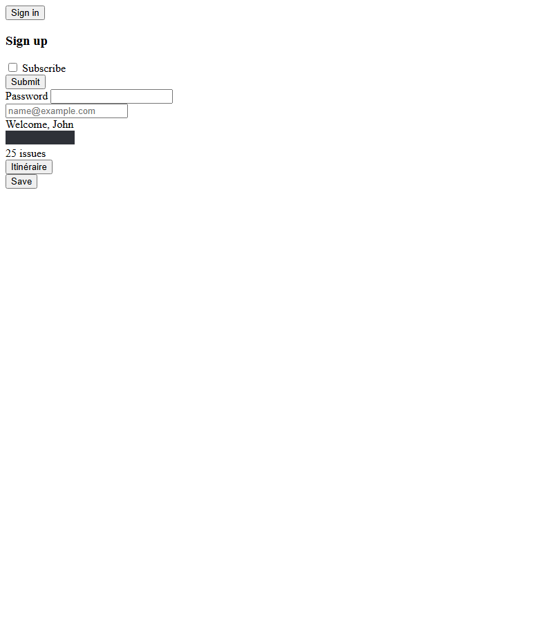
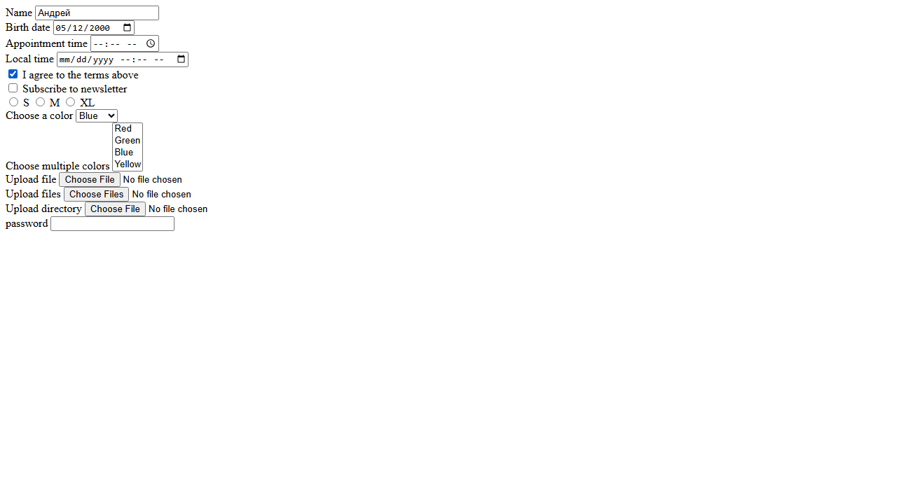

# Playwright: шпаргалка, чтобы понять и запомнить

Петрин Андрей Андреевич. Практика по [документации Playwright](https://playwright.dev/python/docs).

Читать сверху вниз: 10 минут на схему и формулы, потом таблицы по мере надобности.
В конце — вопросы преподавателя с короткими ответами. Всё, что здесь написано,
я реально запускал в этом репозитории.

---

## 1. Как всё устроено

```
pytest ──запускает──► тест (функция test_...)
                        │
                        │ берёт готовую page из фикстуры
                        ▼
playwright ──► browser ──► context ──► page ──► locator ──► действие / проверка
(движок)       (Chrome)    (профиль)   (вкладка)  (элемент)
```

Пять слов, которые надо знать:

| Слово | Простыми словами |
|---|---|
| **playwright** | движок, который управляет браузером |
| **browser** | сам браузер: chromium, firefox или webkit |
| **context** | профиль браузера: свои куки и localStorage. Аналог «чистого окна» |
| **page** | одна вкладка |
| **locator** | правило поиска элемента на вкладке |

Главное: **browser один, контекстов много, у каждого контекста свои вкладки**.
Из этого растёт вся изоляция тестов.

---

## 2. Любой тест — это три шага

```
локатор  →  действие  →  проверка
```

```python
from playwright.sync_api import Page, expect

def test_get_started(page: Page):
    page.goto("https://playwright.dev/")                     # открыть страницу
    page.get_by_role("link", name="Get started").click()      # действие
    expect(page.get_by_role("heading", name="Installation")).to_be_visible()  # проверка
```

- `page` — фикстура: pytest-playwright сам поднимает браузер и закрывает его.
- `expect` — проверка с повтором: несколько секунд ждёт, потом падает.
- `assert` — проверка без ожидания, один раз.

---

## 3. Локаторы: чем искать

Правило выбора: **роль → подпись/текст → test id → CSS**, от человеческого к техническому.

| Метод | Что ищет | Пример |
|---|---|---|
| `get_by_role("button", name="Submit")` | тип элемента + его название | кнопки, ссылки, заголовки, чекбоксы |
| `get_by_label("Password")` | поле по подписи | формы |
| `get_by_placeholder("name@example.com")` | поле по подсказке внутри | формы без label |
| `get_by_text("Welcome, John")` | текст внутри элемента | абзацы, ячейки |
| `get_by_alt_text("playwright logo")` | картинка по alt | изображения |
| `get_by_title("Issues count")` | по атрибуту `title` | иконки с подсказкой |
| `get_by_test_id("directions")` | по `data-testid` | то, что специально для тестов |
| `page.locator("css=button")` | CSS-селектор | когда других вариантов нет |
| `page.locator("xpath=//button")` | XPath | старые проекты |

Уточнения, когда элементов несколько:

| Приём | Что делает |
|---|---|
| `.first` / `.last` / `.nth(2)` | взять один из найденных |
| `expect(locator).to_have_count(3)` | проверить количество |
| `.filter(has_text="Add to cart")` | оставить те, где есть текст |
| `.filter(has=page.get_by_role("button"))` | оставить те, внутри которых есть элемент |
| `.filter(has_not_text="Out of stock")` | убрать лишние |
| `a.and_(b)` / `a.or_(b)` | оба условия / любое из двух |
| `outer.within` (через `and_`/фильтры) | искать только внутри другого локатора |

**Строгий режим (strict mode):** если локатор нашёл несколько элементов, а действие
одно — Playwright падает с ошибкой, а не выбирает наугад. Это защита от клика не туда.

---

## 4. Действия: что можно делать

| Задача | Код |
|---|---|
| ввести текст | `locator.fill("текст")` |
| печатать по буквам | `locator.press_sequentially("текст")` |
| нажать | `locator.click()`, `dblclick()`, `click(button="right")` |
| клик с зажатой клавишей | `click(modifiers=["Shift"])` |
| навести | `locator.hover()` |
| галочка | `locator.check()` / `uncheck()` / `set_checked(True)` |
| список | `select_option("blue")` или `select_option(label="Blue")` |
| клавиши | `locator.press("Enter")`, `press("Control+ArrowRight")` |
| файл | `locator.set_input_files("myfile.pdf")` |
| перетащить | `source.drag_to(target)` |
| прокрутить | обычно сам, вручную `scroll_into_view_if_needed()` |

---

## 5. Проверки: что можно проверять

| Проверка | О чём |
|---|---|
| `to_be_visible()` / `to_be_hidden()` | видно или нет |
| `to_be_enabled()` / `to_be_disabled()` | активен или заблокирован |
| `to_be_checked()` | галочка стоит |
| `to_have_text("...")` / `to_contain_text("...")` | текст целиком / часть |
| `to_have_value("...")` | значение поля или списка |
| `to_have_count(3)` | сколько элементов |
| `to_have_attribute("href", "...")` | атрибут |
| `to_have_class(...)` / `to_have_css("color", "red")` | стили |
| `expect(page).to_have_url("...")` | адрес страницы |
| `expect(page).to_have_title("...")` | заголовок вкладки |
| `expect(page).to_match_aria_snapshot("...")` | структура страницы для незрячих |

Полезное рядом:

```python
expect(locator, "кнопка отправки должна быть видна").to_be_visible()   # своё сообщение
expect.soft(locator).to_be_visible()                                   # не рвёт тест
expect(locator).to_be_visible(timeout=10_000)                          # ждать дольше
```

---

## 6. Авто-ожидание: почему не нужен sleep

Перед каждым действием Playwright сам проверяет условия и только потом действует:

```
нашёл ровно 1 элемент → виден → не двигается 2 кадра → сверху никто не мешает
→ включён → не inert → ДЕЙСТВИЕ
```

Если чего-то нет — ждёт до таймаута (по умолчанию 30 секунд) и падает с понятной
ошибкой: `intercepts pointer events`, `element is inert`, `Timeout 30000ms exceeded`.

Поэтому `time.sleep()` не нужен: он останавливает всю программу и делает тест
медленным и нестабильным. Нужна пауза внутри страницы — `page.wait_for_timeout(500)`.

| Что считается | Правило |
|---|---|
| видимый | есть размер и не `visibility: hidden` |
| включённый | нет `disabled`, `aria-disabled`, родительского `fieldset[disabled]` |
| редактируемый | включён и не `readonly` |

Ловушка: `opacity: 0` **считается** видимым, а элемент нулевого размера — нет.

---

## 7. Фикстуры и изоляция

```
тест 1 ──► новый context ──► новая page ──► закрыли всё
тест 2 ──► новый context ──► новая page ──► закрыли всё
```

Поэтому во втором тесте нет куки и localStorage первого. Это и есть изоляция.

Свои настройки — в `conftest.py`:

```python
import pytest

@pytest.fixture(scope="session")
def browser_context_args(browser_context_args):
    return {**browser_context_args, "viewport": {"width": 1280, "height": 720}, "locale": "en-GB"}

@pytest.fixture(autouse=True)
def open_site(page):
    page.goto("https://playwright.dev/")
    yield
```

| Нужно | Как |
|---|---|
| тест в двух браузерах | `pytest --browser webkit --browser firefox` |
| видеть браузер | `pytest --headed`, медленно — `--slowmo 500` |
| телефон | `pytest --device="iPhone 13"` |
| короткие адреса | `pytest --base-url https://playwright.dev`, в тесте `page.goto("/python/docs/intro")` |
| только chromium | `@pytest.mark.only_browser("chromium")` |
| пропустить в firefox | `@pytest.mark.skip_browser("firefox")` |

Без pytest (обычный скрипт):

```python
from playwright.sync_api import sync_playwright

with sync_playwright() as p:
    browser = p.chromium.launch()
    page = browser.new_page()
    page.goto("https://playwright.dev/")
    print(page.title())
    browser.close()
```

---

## 8. Когда тест упал: что смотреть

1. `pytest --headed` — увидеть глазами.
2. `$env:PWDEBUG=1; pytest -s` — Inspector, шаг за шагом.
3. `pytest --tracing on` → `test-results/.../trace.zip` → `playwright show-trace <путь>`.
   В трассе: шаги, снимки страницы, сеть, консоль, исходный код.
4. `$env:DEBUG="pw:api"; pytest -s` — лог каждого действия Playwright.
5. `--video on` или `--screenshot only-on-failure` — запись и снимки.

Полезные артефакты в git не кладут: `test-results/` есть в `.gitignore`.

---

## 9. Сеть, моки и API без браузера

```python
# подменить ответ сервера
page.route("**/api/v1/fruits", lambda route: route.fulfill(json=[{"name": "Банан"}]))

# изменить настоящий ответ
def handler(route):
    response = route.fetch()
    data = response.json()
    data.append({"name": "Манго"})
    route.fulfill(response=response, json=data)

# оборвать запрос или вернуть ошибку
page.route("**/*.css", lambda route: route.abort())
route.fulfill(status=500, body="server error")
```

Запросы без браузера (быстрее и надёжнее для API):

```python
request_context = playwright.request.new_context(base_url="http://127.0.0.1:8000")
response = request_context.get("/issues")
assert response.ok
print(response.json())
request_context.dispose()
```

Вход один раз, потом переиспользовать:

```python
context.storage_state(path="playwright/.auth/state.json")        # сохранить
browser.new_context(storage_state="playwright/.auth/state.json") # открыть уже с куками
```

---

## 10. Карта документации: что где лежит

| Раздел | О чём в одну строку |
|---|---|
| Installation | установка, первый тест, `page` из фикстуры |
| Writing tests | три шага теста, изоляция, фикстуры |
| Generating tests | `playwright codegen` — запись действий и Pick Locator |
| Running and debugging | `--headed`, `--browser`, `-k`, `PWDEBUG=1` |
| Trace viewer | запись прогона в `trace.zip`, разбор падений |
| Setting up CI | запуск тестов на GitHub Actions |
| Pytest Plugin Reference | все флаги и фикстуры плагина |
| Library | работа без pytest: `sync_playwright`, async, скрипты |
| Actions | все действия: клики, ввод, файлы, перетаскивание |
| Auto-waiting | какие условия Playwright проверяет перед действием |
| API testing | запросы через `request.new_context` |
| Assertions | список всех `expect`, soft, таймауты |
| Authentication | `storage_state`, вход один раз |
| Browsers | chromium, firefox, webkit, каналы Chrome и Edge |
| Chrome extensions | запуск расширения, `service_workers`, `chrome-extension://` |
| Clock | управление временем на странице |
| Debugging Tests | Inspector, `page.pause()`, `DEBUG=pw:api` |
| Dialogs | `alert`, `confirm`, `prompt` — **обязательно** `accept`/`dismiss` |
| Downloads | `expect_download()`, `save_as()` |
| Emulation | телефон, локаль, часовой пояс, геолокация, тёмная тема |
| Evaluating JavaScript | `evaluate`, `evaluate_handle`, `expose_function` |
| Events | `expect_request`, `expect_popup`, `on("console")` |
| Extensibility | свой движок селекторов |
| Frames | `frame_locator`, `page.frame(name)` |
| Handles | ссылки на объекты в браузере |
| Isolation | несколько контекстов, независимые куки |
| Locators | все способы поиска, фильтры, списки |
| Mock APIs | подмена ответов сервера |
| Navigations | `goto`, `wait_for_url`, назад/вперёд, BFCache |
| Network | блокировка запросов, события, прокси |
| Other locators | `:has-text`, `:nth-match`, `:right-of`, `:near` |
| Pages | несколько вкладок, `expect_page` |
| Page object models | класс страницы вместо локаторов в тесте |
| Screenshots | страница, вся страница, элемент |
| Service Workers | блокировка и перехват |
| Snapshot testing | сравнение по дереву доступности |
| Test generator | флаги codegen: устройство, тема, геолокация |
| Touch events | жесты пальцем через `dispatch_event` |
| Videos | запись видео прогона |
| WebView2 | браузер внутри Windows-приложения через CDP |

Скриншот страницы, на которой я проверял локаторы:



Скриншот из теста с формой заказа (день 3):



---

## 11. Пять ошибок, которые поймал я (поймаешь и ты)

1. **Строгий режим.** `get_by_role("textbox")` нашёл 5 полей → тест упал.
   Лечится уточнением: `get_by_label(...)` или `.first`.
2. **Диалог без ответа.** Обработчик `page.on("dialog", ...)` без `accept()`/`dismiss()`
   вешает клик до таймаута.
3. **Смена темы не видна.** После `emulate_media(color_scheme="light")` или
   `set_geolocation` нужен `page.reload()`: страница записала значения при загрузке.
4. **`file://` не всё умеет.** Запросы `fetch` и service worker работают только по
   `http://`, поэтому я поднимал маленький сервер `day5/server.py`.
5. **`evaluate_handle` — это JavaScript, а не селектор.** `"#button1"` даёт ошибку,
   нужно `"window.button1"`.

---

## 12. Вопросы преподавателя и короткие ответы

**Что такое Playwright?** Библиотека, которая управляет браузером: открывает страницы, нажимает, проверяет.

**Зачем pytest?** Он находит функции `test_...`, запускает их и показывает результат.

**Зачем pytest-playwright?** Даёт фикстуры `page`/`context`/`browser` и флаги `--browser`, `--headed`.

**Откуда в тесте `page`?** Из фикстуры плагина: она поднимает браузер до теста и закрывает после.

**Чем `expect` отличается от `assert`?** `expect` ждёт и повторяет проверку, `assert` проверяет один раз.

**Что такое локатор?** Правило поиска элемента: роль, текст, подпись, test id, CSS.

**Почему `get_by_role` лучше CSS?** Ищет как человек: по роли и названию. Не ломается от смены вёрстки.

**Что такое strict mode?** Если найдено несколько элементов, а действие одно — ошибка вместо случайного выбора.

**Как работать со списком?** `.first`, `.nth(i)`, `to_have_count(n)`, `.all()`.

**Чем `filter(has_text)` отличается от `filter(has)`?** Текст внутри элемента против вложенного элемента.

**Что такое авто-ожидание?** Playwright сам ждёт: элемент один, видим, стабилен, не перекрыт, включён.

**Почему не нужен `sleep`?** Он тормозит всю программу и делает тест нестабильным.

**Что такое фикстура?** Подготовка перед тестом. `autouse=True` — для всех тестов файла.

**Что такое изоляция тестов?** У каждого теста свой контекст, поэтому куки и localStorage не переходят между тестами.

**Почему тесты идут без окна браузера?** По умолчанию headless. `--headed` показывает окно.

**Что такое трасса?** Запись прогона: шаги, снимки, сеть, консоль. Включается `--tracing on`.

**Как разобрать упавший тест только на CI?** Скачать артефакт `playwright-traces` и открыть `trace.zip`.

**Зачем `--with-deps` в CI?** Ставит системные библиотеки, без них браузер на сервере не запустится.

**Как не входить в систему в каждом тесте?** Сохранить `storage_state` один раз и открывать контекст с ним.

**Как проверить API без браузера?** `request.new_context(base_url=...)`, потом `get`/`post` и `response.json()`.

**Как подменить ответ сервера?** `page.route(url, handler)` и внутри `route.fulfill(json=...)`.

**Как заблокировать картинки или css?** `page.route("**/*.css", lambda route: route.abort())`.

**Как кликнуть по элементу внутри рамки?** `page.frame_locator(".frame-class").get_by_label(...)`.

**Зачем Page Object?** Локаторы и действия живут в классе страницы, тест читается как сценарий.

**Как проверить тёмную тему?** `page.emulate_media(color_scheme="dark")`, потом `reload()`.

**Что такое aria snapshot?** Сравнение структуры страницы для незрячих: заголовки, ссылки, поля.

**Как кликнуть по элементу, который перекрыт?** Сначала понять почему. `force=True` — крайний случай.

**Как запустить тесты параллельно?** Плагин `pytest-xdist` и `--numprocesses 2`.

**Что было самым сложным?** CI: тесты браузеров падали, потому что на сервере был установлен только chromium.

---

## 13. Команды одной строкой

```bash
uv sync                                     # поставить зависимости
uv run playwright install chromium          # скачать браузер
uv run pytest                               # все тесты
uv run pytest day5 -v --tb=line             # один день, короткие ошибки
uv run pytest -k "dialog or frame" -v       # по части имени
uv run pytest --headed --slowmo 500         # смотреть глазами
uv run pytest --browser firefox --browser webkit
uv run pytest --tracing on                  # трасса в test-results
uv run playwright show-trace test-results/x/trace.zip
uv run playwright codegen https://playwright.dev
```

PowerShell для отладки:

```powershell
$env:PWDEBUG=1; uv run pytest -s     # Inspector
$env:DEBUG="pw:api"; uv run pytest -s # лог действий
```

---

## 14. Что было сделано за 5 дней

| День | Разделы | Тесты |
|---|---|---|
| 1 | Installation, Library (Usage) | 3 теста + 2 скрипта |
| 2 | Writing tests, Locators | 40 |
| 3 | Generating tests, Running and debugging, Trace, CI, Pytest plugin, Library, Actions, Auto-waiting | 41 |
| 4 | API testing, Assertions, Authentication, Browsers, Chrome extensions, Clock, Debugging, Dialogs, Downloads, Emulation, Evaluating, Events | 69 |
| 5 | Extensibility, Frames, Handles, Isolation, Mock APIs, Navigations, Network, Other locators, Pages, POM, Screenshots, Service Workers, Snapshot testing, Test generator, Touch events, Trace, Videos, WebView2 | 52 |

Весь прогон: **207 passed, 1 skipped**. Подробности — в `README.md`.
